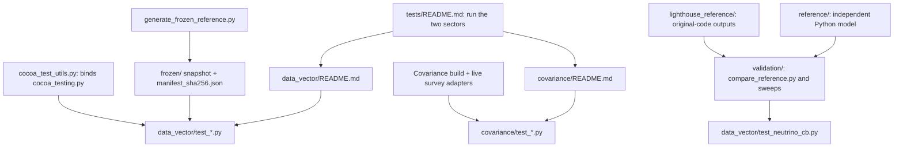

# Tests

The DES cluster tests and optional studies are organized as follows.

- [Data-vector and likelihood checks](data_vector/README.md) cover the project
  predictions, frozen inputs and numerical diagnostics.
- [Covariance checks](covariance/README.md) cover forecast assembly and its
  documented component checks. Covariance generation must be compiled.
- <a name="optional_studies"></a>[Optional studies](studies/README.md#optional_studies)
  compare n(z) reconstructions and numerical accuracy, with plots and
  $\Delta\chi^2$ results. Run them separately from the routine tests.



Read this page first, then the guide of the sector to run. The data-vector
tests read the frozen snapshot, which `generate_frozen_reference.py` writes
and `manifest_sha256.json` protects, through the shared machinery that
`cocoa_test_utils.py` binds; the exception is `test_neutrino_cb.py`, which
builds its state from the live likelihood and dataset through
`validation/compare_reference.py` and the `reference/` modules. The
covariance tests need the covariance build and read the live survey
adapters in `covariance/`. pytest does not collect `reference/`,
`validation/` and `lighthouse_reference/` by default; the
[validation tools section](#des_cluster_validation) describes these
validation tools.

The data-vector sector includes the setting-sequence tests
(`data_vector/test_setting_sequences.py`): they change cosmolike
settings in one process, as a notebook does between evaluations, and
compare every result bit for bit with a separate process that saw only
the final settings. A change the loaded data layout cannot follow must
stop with a clear message instead of returning numbers computed from
the earlier settings. The cluster sequences assert those refusals: a
cluster probe selection or the Y transform changed after the cluster
data files are loaded stops with a message naming `init_data_cluster`,
and so does a cluster evaluation after `initial_setup` alone.

These steps assume Cocoa and this project are installed, the Cocoa Conda environment
is active, the shell is Bash, and the current folder is `cocoa/Cocoa/`.

Run the sectors in separate Python invocations: they initialize different
compiled-library state. Running one project at a time also avoids importing
another project's same-named test helpers.

**Step :one:**: activate Cocoa.

```bash
source start_cocoa.sh
```

**Step :two:**: run the data-vector sector.

```bash
python -m pytest ./projects/des_cluster/tests/data_vector
```

**Step :three:**: enable covariance generation.

```bash
unset IGNORE_COSMOLIKE_DES_CLUSTER_COVARIANCE
```

**Step :four:**: compile the project.

```bash
source ./projects/des_cluster/scripts/compile_des_cluster.sh
```

**Step :five:**: run the covariance sector.

```bash
python -m pytest ./projects/des_cluster/tests/covariance
```

The project must be enabled in `set_installation_options.sh` before
activation. A covariance skip in a deliberately disabled build is expected;
it is not a successful covariance check. Read the sector guide to distinguish
asserted regressions from advisory accuracy reports.

Frozen configurations and inputs are protected by `manifest_sha256.json`.
Do not regenerate references to silence an unexplained failure. The
[data-vector guide](data_vector/README.md#refreeze) documents the deliberate
reference-update procedure and its limits; the covariance sector stores no
reference values.

Hybrid examples can be checked without sampling:

**Step :one:**: check configuration 1.

```bash
python ./projects/des_cluster/EXAMPLE_EMUL2_MINIMIZE1.py --check
```

**Step :two:**: check configuration 2.

```bash
python ./projects/des_cluster/EXAMPLE_EMUL2_MINIMIZE2.py --check
```

## Validation tools <a name="des_cluster_validation"></a>

An unqualified pytest run collects only `tests/data_vector`, and pytest never descends into the three validation folders below; each is run on its own.

- `tests/reference/` holds an independent Python reference model of the cluster observables and of the joint Gaussian covariance, with its own tests:

      python -m pytest ./projects/des_cluster/tests/reference

- `tests/validation/compare_reference.py` compares the compiled code with the Python reference, quantity by quantity (selection kernels, number density and bias per richness bin, one-halo power spectrum, counts, Limber spectra, real-space statistics, and the cluster blocks of the data vector), and checks that the data vector is bitwise identical at 1 and 8 OpenMP threads:

      python ./projects/des_cluster/tests/validation/compare_reference.py --threads 4

  [PORT_PLAN.md](../PORT_PLAN.md) records the result: every cluster quantity matches the reference to $2\times10^{-5}$ or better, except cluster lensing, which differs by $10^{-3}$ in the tail of the lowest source bins behind the highest cluster bin; on the cluster-lensing block this amounts to $\Delta\chi^2 = 3.4\times10^{-5}$ with the scale cuts and $2.0\times10^{-4}$ without them.

The reference comparison returns a failure when a matched-input,
matched-nuisance or production row misses its stated target, or when a
thread/return-to-point check fails. Its JSON record is written first so the
failure can be diagnosed. Comparisons deliberately using different physical
assumptions remain advisory. The inexpensive
`data_vector/test_validation_acceptance.py` checks this acceptance decision
with mocked numerical tables; it does not replace the actual reference run.

- `tests/validation/knob_sweep.py` measures the accuracy settings one at a time with the small scales visible. It reuses the cache of `compare_reference.py`:

      OMP_NUM_THREADS=4 python ./projects/des_cluster/tests/validation/knob_sweep.py \
        --cache-dir <compare_reference cache> --cov ./projects/des_cluster/data/des_cluster_y6_cov.npy

- `tests/lighthouse_reference/` holds data vectors and intermediate quantities computed with the original CosmoLike cluster code (the `lighthouse` repository), kept for comparison. Its [README](lighthouse_reference/README.md) documents the configuration and lists where that code deviates from the model of the paper. The port follows the paper, apart from the choices documented in the [project README](../README.md) (the volume-only cluster kernel by default, the cluster-lensing pairs kept and masked, Limber-only $w_{cc}$ and $w_{cg}$), so this comparison is a sanity check at the percent level: `compare_reference.py` measures counts that agree to 2.4% and a cluster bias that agrees to 0.8% ([PORT_PLAN.md](../PORT_PLAN.md), section 7; the original code integrates with a relative tolerance of $10^{-2}$).

## Timing <a name="des_cluster_timing"></a>

`tests/validation/time_cosmolike.py` times the data vector per probe set: after one warm-up, every timed evaluation moves every sampled parameter, so no table is served from a cache, and the timer of the likelihood is read apart from the timer of CAMB.

    OMP_NUM_THREADS=8 OPENBLAS_NUM_THREADS=1 VECLIB_MAXIMUM_THREADS=1 \
      python ./projects/des_cluster/tests/validation/time_cosmolike.py

`tests/validation/time_lighthouse.py` times the original CosmoLike cluster code in the same way; it needs the prebuilt library of that code, which is not part of Cocoa.

Published timings are maintained in
[Cocoa's main README](https://github.com/CosmoLike/cocoa#overview).
[PORT_PLAN.md](../PORT_PLAN.md) retains the historical port measurements.

## Matter-emulator support <a name="matter_emulator_support"></a>

[check_matter_emulator_support.py](check_matter_emulator_support.py) asks the
candidate Cobaya provider for the two matter fields required by this
project: total matter (`delta_tot`) and cold matter (`delta_nonu`, baryons
plus cold dark matter). It uses fixed neutrino mass 0.06 eV. This small
check precedes any random-cosmology accuracy comparison, because replacing
cold matter by total matter would change the physical model. The active
cluster mass function reads the cold-matter variance. The existing EMUL2
likelihood approximates its spectrum as $`P_{cb}=P_{\rm lin}/(1-f_\nu)^2`$,
where $`f_\nu=\Omega_\nu/\Omega_m`$. This small-scale approximation cannot
be counted as a separately supplied emulator prediction.

**Step :one:**: select the candidate code checkout.

```bash
export EMULATOR_CODE_DIR=/path/to/emulators_code
```

**Step :two:**: select its model-data checkout.

```bash
export EMULATOR_DATA_DIR=/path/to/emulators_data_lcdm
```

**Step :three:**: run from activated Cocoa. This small support check
uses one thread for each numerical library.

```bash
python projects/des_cluster/tests/check_matter_emulator_support.py
```

The result is written to `chains/matter_emulator_prior/support.txt`.
The check explicitly enables `cold_power: eisenstein_hu`, using the project's
number of massive species. It verifies the linear-field interface at fixed
mass in flat LCDM. It does not establish the approximation's accuracy or
supply nonlinear cold power. Exit status 1 reports a missing required field.

## Cold-matter substitution error

`compare_cold_total_power.py` isolates the error of using total power where
the likelihood requests linear cold power. It uses CAMB in both runs,
retains the actual neutrino density and all other model choices, and keeps
the measurement covariance fixed. Each command starts a fresh process, so a
cached native table cannot conceal a changed spectrum. The three points are
the current first example's fiducial and two changes of Omega_m to 0.25 and
0.40, all at mnu=0.06 eV. Other fiducial parameters stay fixed.

Run from activated Cocoa, first with the true cold spectrum:

```bash
python projects/des_cluster/tests/compare_cold_total_power.py --mode exact --output projects/des_cluster/chains/cold_total_mnu006
```

Then replace only cold power with total power:

```bash
python projects/des_cluster/tests/compare_cold_total_power.py --mode total --output projects/des_cluster/chains/cold_total_mnu006
```

The saved vectors, spectrum ratios, configuration and native/source revisions
remain under `chains/`. The reported distance is the prediction difference
contracted with the covariance inverse, not the difference between two fits
to the observed data. For a finite-simulation likelihood it remains a
Gaussian covariance-distance diagnostic, not a change in that log-likelihood.

The cluster test also isolates the constant correction already used by its
EMUL2 route:

```bash
python projects/des_cluster/tests/compare_cold_total_power.py --mode rescaled --output projects/des_cluster/chains/cold_total_mnu006
```

Compare the scale-dependent Eisenstein-Hu ratio at the same neutrino mass:

```bash
python projects/des_cluster/tests/compare_cold_total_power.py --mode eh --output projects/des_cluster/chains/cold_total_mnu006
```

At the 24 November 2026 run, the 4x2pt+counts covariance distances were:

| Omega_m | Total substituted | Constant correction | Eisenstein-Hu ratio |
|---|---:|---:|---:|
| 0.30 (fiducial) | 3.16992 | 0.007701 | 0.00002159 |
| 0.25 | 1.72934 | 0.004175 | 0.00000497 |
| 0.40 | 8.36589 | 0.027625 | 0.00015613 |

The uncorrected fiducial counts decrease by 1.32--3.75% across retained bins
(median 2.25%). The Eisenstein-Hu power residual is below 0.034% on the
sampled grid, k=0.0001--10 1/Mpc and z=0--2. The corrected field approximation
is therefore small in these tests; the neural-network error is additional.
The tests do not bound errors across the whole prior or validate dynamical
dark energy. The actual provider option and its field/state tests are
explained in the emulator-code README.

## Official hybrid-emulator test

The command-line driver can distribute independent cosmologies and Fisher
columns over MPI, following the LSST Y1 × DESI Fisher calculation. For one
project with two ranks and four OpenMP threads per rank, run:

```bash
mpirun -n 2 --bind-to none python -m mpi4py \
  projects/des_cluster/tests/compare_emulator_camb.py --mpi --advisory
```

Run one project at a time with this allocation. Each rank owns a separate
model and evaluates different points or derivative columns. OpenMP works
inside each evaluation; BLAS stays at one thread. Rank zero assembles and
writes the combined results. The `--mpi` flag is required: simply launching
the serial driver twice would repeat work and write to the same files.
`python -m mpi4py` also stops the other ranks if an uncaught error terminates
one rank. Plot-only runs use rank zero and need no MPI launch.


The E5 test follows LSST Y1: fifty random cosmologies drawn from the
numbered example, restricted to 0.2 < Omega_m < 0.5, fixed mnu=0.06 eV,
and 10^9 A_s <= 3.5. Both routes use plain mead2020 and CAMB background
quantities. The candidate supplies total power and approximate linear cold
power through the explicit Eisenstein-Hu option. It uses the installed
emulator code and data; environment overrides are the same as LSST Y1.

```bash
python -m pytest -s projects/des_cluster/tests/data_vector/test_emul2.py
```

Each invocation creates a separate `chains/hybrid_emulator_tests/` directory.
The statistic is the direct vector difference contracted with the fixed
precision, with no data-residual linear term. The Fisher calculation uses
CAMB derivatives at two step sizes and marginalizes the sampled nuisance
parameters with their Gaussian prior curvature and hard bounds. Its figure
uses the approved error thresholds 0.2, 0.5 and 1, the project title and the
3.5 amplitude cap. These contours describe a centered local forecast,
not a fit to the observed posterior. The shared test also selects 25 local
cosmologies from the fully marginalized bounded Fisher sample. Both CAMB
and emulator use fixed evaluate-1 nuisance values for these accuracy tests,
as for the broad-prior comparisons. The resulting points appear as filled
markers beside the open prior markers.
Error bands have distinct colors and shapes; failed evaluations use crosses.
Their separate predictions and errors are saved under `local/` within the
same run directory. `--local-points` supplies a different named parameter
table when an explicit study calls for one. Accuracy exceedances are recorded;
incomplete numerical comparisons or a failed Fisher calculation fail E5.

This test uses example 1's full cluster-plus-galaxy vector. It fixes
w=-1 and w_a=0 because the cold-field conversion has only been validated
for flat LCDM. It checks that the example's amplitude cut cannot reject
any point in the capped parameter box before removing that redundant
external prior from the saved test configuration. The production CAMB
example retains its original dark-energy priors and amplitude cut.

The native accuracy-control regression also checks the historical signed
integration controls in fresh processes. It accepts levels -1, 10 and 62,
and rejects values outside the core's supported range. Level 10 in the
high-accuracy advisory suite is intentional; this guard check does not
establish convergence of a Fisher matrix or a survey covariance.
